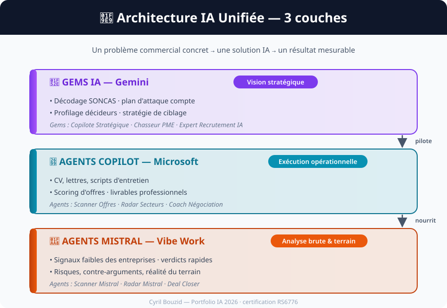
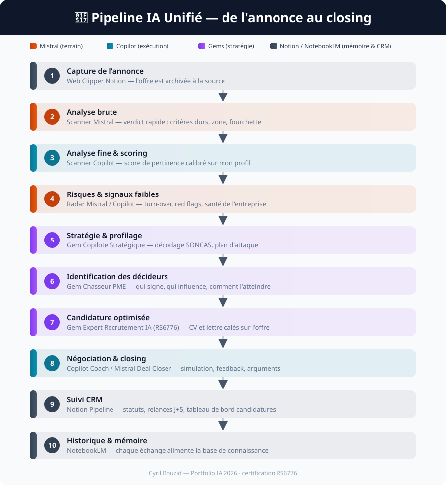
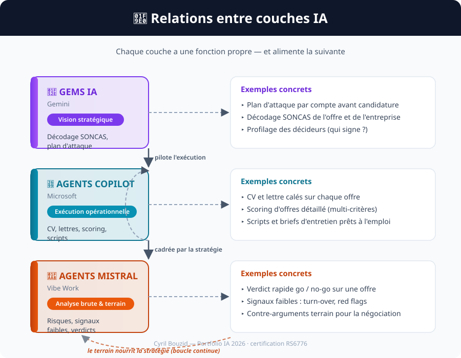

# 📄 Architecture IA Unifiée

> **Vue détaillée du système** : comment trois technologies complémentaires structurent ma recherche d'emploi et ma stratégie commerciale. Pour une vue d'ensemble en 30 secondes, voir le [README](README.md).

## 🚀 Vue d'ensemble

Ce portfolio repose sur un **écosystème IA professionnel** conçu pour automatiser la prospection, la stratégie commerciale et le recrutement, autour de trois couches :

- **GEMS IA (Gemini)** → Vision stratégique
- **AGENTS COPILOT (Microsoft)** → Exécution opérationnelle
- **AGENTS MISTRAL (Vibe Work)** → Analyse brute & terrain

---

## 🧩 Architecture IA Unifiée

**Lecture :** les Gems IA définissent la stratégie et le ciblage · les Agents Copilot produisent les livrables professionnels · les Agents Mistral réalisent les analyses rapides et brutes.

---

## 🔗 Pipeline IA Unifié

**Étapes clés :**

1. **Capture annonce** → Web Clipper Notion
2. **Analyse brute** → Scanner Mistral
3. **Analyse fine** → Scanner Copilot
4. **Risques & signaux faibles** → Radar Mistral / Copilot
5. **Stratégie & profilage** → Gem Copilote Stratégique
6. **Identification décideurs** → Gem Chasseur PME
7. **Candidature optimisée** → Gem Expert Recrutement IA (RS6776)
8. **Négociation & closing** → Copilot Coach / Mistral Deal Closer
9. **Suivi CRM** → Notion Pipeline
10. **Historique & mémoire** → NotebookLM

---

## 🧠 Relations entre couches IA

| Couche | Fonction principale | Exemple |
|--------|---------------------|----------|
| **GEMS IA (Gemini)** | Vision stratégique | Décodage SONCAS, plan d'attaque |
| **AGENTS COPILOT (Microsoft)** | Exécution opérationnelle | CV, lettres, scoring, scripts |
| **AGENTS MISTRAL (Vibe Work)** | Analyse brute & terrain | Risques, signaux faibles, verdicts |

Une **boucle continue** relie le terrain à la stratégie : chaque verdict brut alimente le profilage des prochaines cibles.

---

## 🧬 Correspondance Projets ↔ Gems ↔ Agents

| Projet | Gem associé | Copilot | Mistral |
|--------|--------------|----------|---------|
| [Scanner Offres](scanner-offres-emploi/) | Expert Recrutement IA | Scanner Offres | Scanner Mistral |
| [Radar Secteurs](radar-secteurs-toxiques/) | Copilote Stratégique | Radar Secteurs | Radar Secteurs Mistral |
| [Coach Négociation](coach-negociation/) | Chasseur PME & Décideurs | Coach Négociation | Deal Closer Mistral |

---

## 🎯 Ce que prouve cette architecture

- **Lisibilité totale** : chaque projet est relié à ses trois couches IA
- **Cohérence métier** : stratégie (Gemini), exécution (Copilot), analyse brute (Mistral)
- **Positionnement RS6776** : un savoir-faire commercial transformé en pipeline IA complet

---

> 💡 **Ces outils tournent en production** sur ma propre recherche d'emploi — cette architecture n'est pas une démonstration théorique.
